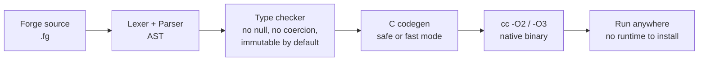

# 🔴 Forge v2 — a production-oriented language, rebuilt from research

> **Safe. Simple. Natively fast.**
> Static types, no null, immutable by default, checked arithmetic —
> with C++-style latency and Mojo/Python-style ML ease, in one binary.


Forge v2 is a statically typed language that compiles to native code.
It was restarted from scratch after a research pass over what people
are actually building in 2025–2026 — Zig, Mojo, Carbon, Gleam, Odin,
Hare, Roc, Vale/Valen, and others — and what developers praise and
complain about in Rust, Go, Zig, and Mojo. The conclusion that drives
Forge: **no single language has replaced Rust/Go/C, and the ones
gaining real production use have a narrow beachhead, not a promise
to be good at everything.** Forge's beachhead is safe, simple, fast
tools, CLIs, and small ML programs.

---

## 🌙 The 3D picture: what learning looks like in Forge

This is the loss surface for the linear-regression example in this
repo (`examples/ml_linear_regression.fg`, data `y = 2x + 1`).
Gradient descent walks down this bowl toward the star at `w = 2,
b = 1, loss = 0`. The surface is computed from that exact data;
the walk itself is a real Forge program (see the convergence curve
below).


---

## ⚡ Microsecond latency, measured — not claimed

A dot product is the unit of ML work. This is real Forge timing
(`examples/benchmark_scaling.fg`, safe mode, 100 repetitions each,
measured on this machine on 26 Oct 2026 — your numbers will vary):

| Vector size | Average time per dot |
|------------:|---------------------:|
| 1,000       | 1.03 µs |
| 5,000       | 5.98 µs |
| 10,000      | 10.67 µs |
| 20,000      | 21.59 µs |


That is roughly **1 microsecond per 1,000 elements** — linear, as it
should be for contiguous arrays. A data-dependent loop of 1,000,000
array reads takes about **1.2 milliseconds** in the same run.

```sh
python3 forge.py run examples/benchmark.fg            # safe mode
python3 forge.py run examples/benchmark.fg --mode fast # -O3 -march=native, unchecked
```

Safe mode is the default: checked integer arithmetic and
bounds-checked indexing, aborting with a readable message instead
of wrapping or crashing. Fast mode is an explicit opt-in for hot
code you have already validated in safe mode.

---

## 🤖 ML in Forge: Python-like to write, native to run

### Linear regression, converging for real

`examples/ml_regression_trace.fg` prints `w` and `b` every 100
iterations. The true line is `y = 2x + 1`:


Final result after 500 iterations (`examples/ml_linear_regression.fg`):

```
w = 2.0211  b = 0.923818
prediction for x=6: 13.0504
```

Close to the true `w = 2, b = 1, prediction = 13` — not exact, and
that honesty matters: 500 steps at learning rate 0.01 does not
finish the job, it gets close.

### A tiny MLP doing XOR

`examples/ml_mlp_xor.fg` uses hand-set sigmoid weights (no Python
runtime, no GPU framework) and produces:

```
xor 0 0 = 0 (raw 4.54391e-05)
xor 0 1 = 1 (raw 0.999955)
xor 1 0 = 1 (raw 0.999955)
xor 1 1 = 0 (raw 4.54391e-05)
```


### Matrix multiply

```sh
python3 forge.py run examples/matrix.fg
# 58 64 139 154
# dot = 217
```

---

## 🧭 How a Forge program becomes a binary



---

## 🚀 Quickstart

Requirements: Python 3 and a C compiler (`cc` / `gcc`).

```sh
python3 forge.py run examples/hello2.fg
python3 forge.py run examples/matrix.fg
python3 forge.py run examples/ml_linear_regression.fg
python3 forge.py run examples/ml_mlp_xor.fg
python3 forge.py run examples/benchmark_scaling.fg
python3 forge.py build examples/benchmark.fg -o bench
python3 tests/run_tests.py   # all tests pass
```

## 🔴 Forge on big32 — your language, running on your own CPU

Forge now has a second backend: instead of C (x86), it can compile
straight to RISC-V assembly for **big32**, the 32-bit CPU in the
`BIG-32` repo. A Forge program compiled this way runs on big32 in
simulation — no x86, no C compiler in the middle. This is simulation
only, and it is a subset (see below); it is not Linux, and big32 is
not silicon.

```sh
python3 forge.py build --target big32 examples/big32/hello.fg -o out/hello
# -> out/hello.s (big32 assembly) + out/hello.hex (for the simulator)
python3 tests/run_big32_tests.py   # model + Verilog, compared with x86
```

How it works (see `forge_lang/codegen_rv.py` for the full contract):

- **Pipeline:** Forge source → existing lexer/parser → existing
  checker → existing type inference → new RISC-V code generator.
  The language is not rewritten; only the backend is new.
- **Calling convention:** args in a0–a7, return in a0, frame
  pointer s0, locals in a fixed 2048-byte frame addressed via s0
  (so sp may move for call spills). The callee saves ra + s0
  only; the caller spills every live temp register across a call,
  so recursion works (fib(10) is the proof).
- **Stack:** starts at 65532, grows down. Static data (strings,
  array slots) lives at 0x1000 and up, in the 64KB data memory.
- **UART runtime:** `print`/`println` map to UART TX — a store of
  each byte to 0x10000000. Integers go through a decimal routine
  (including the INT_MIN case, printed unsigned after the `-`
  sign); strings are null-terminated static data initialised by
  `_start` before `main`; booleans print as `true`/`false`.
- **Arrays:** a static slot per source site — first word is the
  length, then the elements. An array literal inside a loop
  re-initialises the same slot each iteration (a documented v1
  limitation, not a hidden one).
- **End of program:** `main`'s return (or falling off the end)
  becomes ECALL, which halts big32 (mtvec == 0).

Supported on big32 (v1): `int` (32-bit here, not Forge's 64-bit
x86 int), `bool`, `str` literals/variables, `[int]`/`[bool]`/
`[str]` arrays, `let`/`assign`, `if`/`else`, `while`, `for` over
an array or over `range(n)`, functions/calls (≤ 8 args, recursion),
`return`, `print`/`println` of int/bool/str, `len` of an array or
a string, `assert`/`fail` (print, halt with a0 = 1).

NOT supported on big32 (v1), and the backend rejects them with a
clear error instead of silently miscompiling: `float` (would need
soft-float), structs, enums/`match`, `spawn`/threads, `extern`/FFI,
file I/O, `args()`, HTTP, clock, string concatenation/comparison,
`push` (no dynamic allocation), generics, `Option`/`Result`, GC.
Arithmetic is native RISC-V, not Forge safe mode: it wraps on
overflow, div by zero gives -1, rem by zero gives the dividend.

Verified programs (`examples/big32/`, each run on x86, in the
big32 Python model, and in Icarus Verilog, with identical UART):

| Program | UART output |
|---|---|
| `hello.fg` | `hello from Forge on big32` / `forge + big32` |
| `sum.fg` | `sum = 55` |
| `fib.fg` | `fib = 55` (recursive, the call-spill proof) |
| `muldiv.fg` | `mul = 83810205`, `div = 14 rem = 2`, `neg = -42`, `flag = true false` |
| `loop_call.fg` | `total = 14`, `len = 5 xs[2] = 4` |
| `forge_os.fg` | Forge OS demo (below) |

### Forge OS demo — the full-stack program

`examples/big32/forge_os.fg` is a Forge program that boots on
big32, prints a banner, runs two apps, prints their results, and
halts via ECALL. It is an OS *demo* (a user program acting as an
OS), not a trap handler — the assembly kernel `programs/kernel.s`
in the big32 repo remains the real trap-handling supervisor:

```
forge OS on big32
boot ok
app_sum = 55
app_mul = 42
done
```

## ✍️ Language in 30 seconds

```forge
import "ml.fg";

fn main() -> int {
    let xs: [float] = [1.0, 2.0, 3.0];
    let mut total: float = 0.0;
    for v in xs {
        total = total + v;
    }
    println("mean =", mean(xs), "total =", total);
    let t0: int = clock_micros();
    let c: [float] = matmul(xs, xs, 1, 3, 1);
    println("micros =", clock_micros() - t0);
    return 0;
}
```

Types: `int` (64-bit), `float` (64-bit), `bool`, `str`, `[T]` arrays,
plus user-defined **structs** (see `examples/structs_point.fg`).

```forge
struct Point { x: float; y: float; }
let mut q: Point = Point { x: 3.0, y: 4.0 };
q.x = 6.0;
```

Casts are explicit: `x as float`, `y as int`. There is no null and
no implicit conversion.

Builtins: `print` / `println`, `push`, `fail`, `len`, `range`,
`clock_micros`, `sqrt`, `exp`, `log`, `pow`, `abs`,
`read_file` / `write_file`, `args()`, `parse_int`.
Run a program with arguments: `python3 forge.py run examples/file_and_args.fg -- out.txt`.
Run the test suite the Go way: `python3 forge.py test`.
Standard library (`stdlib/ml.fg`, `import "ml.fg"`): `dot`, `mean`,
`relu`, `sigmoid`, `matmul` (flat row-major matrices).

## 📁 Layout

```
forge.py              CLI: check / build / run / emit, --mode safe|fast
forge_lang/           lexer, parser, checker, inference, C codegen, driver
stdlib/ml.fg          dot, mean, relu, sigmoid, matmul
examples/             hello2, matrix, benchmark, benchmark_scaling,
                      ML regression, regression trace, MLP XOR
figures/              README figures (regenerate: scripts/make_figures.py)
scripts/make_figures.py   figure generator, with data provenance notes
tests/                test suite + programs that must fail safely
SPEC_V2.md            the v2 language specification
RESTART.md            why v2 was restarted, and what the research locked in
```

## 📊 What Forge borrows, and what it refuses

Borrowed from the research: explicit checked arithmetic (Zig-style),
error handling that cannot be silently ignored, Result/no-null
thinking (Rust/Gleam-style, without a borrow checker), a
single-binary toolchain (Gleam-style), and stability over churn
(the Zig pre-1.0 breaking-change warning).

Refused: a full Rust borrow checker as the default, Carbon-style
C++ interop as a goal, exceptions for expected errors, unstructured
spawning, and leaving the package manager and editor support until
later — the most common ways new languages stall.

## 🧩 Ecosystem

The full tooling is documented in `docs/ECOSYSTEM.md`:

- **Package manager:** `forge pkg init/add/build/run/test/list` — vendored dependencies, no registry needed
- **Formatter:** `forge fmt <file.fg> [--check]` — idempotent, canonical style
- **Language server:** `forge lsp` — real-checker diagnostics + completion, with a VS Code grammar in `editors/vscode/forge/`
- **REPL:** `forge repl` — keep `let` definitions, evaluate expressions
- **Stdlib:** `ml.fg`, `strings.fg`, `stats.fg` — plus string builtins `split/join/substr/trim/starts_with/ends_with`
- **CI:** `.github/workflows/ci.yml` runs the test suite, formatter check, and ecosystem example

## ⚠️ Honest gaps

Forge v2 is production-*oriented*, not a finished Rust/Go/Mojo
rival. Structs, file I/O, CLI args, `forge test`, the ecosystem,
enums+match, spawn threads, C FFI, HTTP, Map/JSON stdlib, assert,
`forge doc`, a package lockfile, and now generics, `Option`/
`Result`, TLS, a local registry, a tiny KV DB, a big32
backend, `?`, generic enums with payloads, a table DB, a SQL
parser, a self-hosted HTTP registry, a WASM backend, string
GC v1, CPU-thread parallel kernels, Python interop via a
shared library, public registry discovery, array GC v2,
struct GC, Python arrays/structs, CUDA codegen, and a static
GitHub-Pages registry are done (26 Oct 2026), and now also
Python [float]/[str] arrays + nested structs, a CUDA
simulation + ready-to-run package, a dynamic registry
with auth and a Dockerfile, and now CUDA execution verified
on a real Kaggle Tesla T4 GPU (26 Oct 2026). It still has
no registry actually running on a public host yet. That is
the next phase in `SPEC_V2.md`, not a hidden feature.

## 🔁 Regenerate the figures

```sh
python3 scripts/make_figures.py
```

The script documents exactly where every number comes from: the
scaling and trace figures are real Forge program outputs, the XOR
heatmap is real MLP outputs, and the 3D surface is computed from
the regression data itself.
