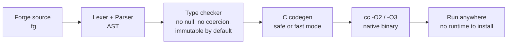

# 🔴 Forge v2 — a production-oriented language, rebuilt from research

> **Safe. Simple. Natively fast.**
> Static types, no null, immutable by default, checked arithmetic —
> with C++-style latency and Mojo/Python-style ML ease, in one binary.


Forge v2 is a statically typed language that compiles to native code.
It was restarted from scratch after a research pass over what people
are actually building in 2025–2026 — Zig, Mojo, Carbon, Gleam, Odin,
Hare, Roc, Vale/Valen, and others — and what developers praise and
complain about in Rust, Go, Zig, and Mojo. The conclusion that drives
Forge: **no single language has replaced Rust/Go/C, and the ones
gaining real production use have a narrow beachhead, not a promise
to be good at everything.** Forge's beachhead is safe, simple, fast
tools, CLIs, and small ML programs.

---

## 🌙 The 3D picture: what learning looks like in Forge

This is the loss surface for the linear-regression example in this
repo (`examples/ml_linear_regression.fg`, data `y = 2x + 1`).
Gradient descent walks down this bowl toward the star at `w = 2,
b = 1, loss = 0`. The surface is computed from that exact data;
the walk itself is a real Forge program (see the convergence curve
below).


---

## ⚡ Microsecond latency, measured — not claimed

A dot product is the unit of ML work. This is real Forge timing
(`examples/benchmark_scaling.fg`, safe mode, 100 repetitions each,
measured on this machine on 26 Oct 2026 — your numbers will vary):

| Vector size | Average time per dot |
|------------:|---------------------:|
| 1,000       | 1.03 µs |
| 5,000       | 5.98 µs |
| 10,000      | 10.67 µs |
| 20,000      | 21.59 µs |


That is roughly **1 microsecond per 1,000 elements** — linear, as it
should be for contiguous arrays. A data-dependent loop of 1,000,000
array reads takes about **1.2 milliseconds** in the same run.

```sh
python3 forge.py run examples/benchmark.fg            # safe mode
python3 forge.py run examples/benchmark.fg --mode fast # -O3 -march=native, unchecked
```

Safe mode is the default: checked integer arithmetic and
bounds-checked indexing, aborting with a readable message instead
of wrapping or crashing. Fast mode is an explicit opt-in for hot
code you have already validated in safe mode.

---

## 🤖 ML in Forge: Python-like to write, native to run

### Linear regression, converging for real

`examples/ml_regression_trace.fg` prints `w` and `b` every 100
iterations. The true line is `y = 2x + 1`:


Final result after 500 iterations (`examples/ml_linear_regression.fg`):

```
w = 2.0211  b = 0.923818
prediction for x=6: 13.0504
```

Close to the true `w = 2, b = 1, prediction = 13` — not exact, and
that honesty matters: 500 steps at learning rate 0.01 does not
finish the job, it gets close.

### A tiny MLP doing XOR

`examples/ml_mlp_xor.fg` uses hand-set sigmoid weights (no Python
runtime, no GPU framework) and produces:

```
xor 0 0 = 0 (raw 4.54391e-05)
xor 0 1 = 1 (raw 0.999955)
xor 1 0 = 1 (raw 0.999955)
xor 1 1 = 0 (raw 4.54391e-05)
```


### Matrix multiply

```sh
python3 forge.py run examples/matrix.fg
# 58 64 139 154
# dot = 217
```

---

## 🧭 How a Forge program becomes a binary



---

## 🚀 Quickstart

Requirements: Python 3 and a C compiler (`cc` / `gcc`).

```sh
python3 forge.py run examples/hello2.fg
python3 forge.py run examples/matrix.fg
python3 forge.py run examples/ml_linear_regression.fg
python3 forge.py run examples/ml_mlp_xor.fg
python3 forge.py run examples/benchmark_scaling.fg
python3 forge.py build examples/benchmark.fg -o bench
python3 tests/run_tests.py   # all tests pass
```

## ✍️ Language in 30 seconds

```forge
import "ml.fg";

fn main() -> int {
    let xs: [float] = [1.0, 2.0, 3.0];
    let mut total: float = 0.0;
    for v in xs {
        total = total + v;
    }
    println("mean =", mean(xs), "total =", total);
    let t0: int = clock_micros();
    let c: [float] = matmul(xs, xs, 1, 3, 1);
    println("micros =", clock_micros() - t0);
    return 0;
}
```

Types: `int` (64-bit), `float` (64-bit), `bool`, `str`, `[T]` arrays,
plus user-defined **structs** (see `examples/structs_point.fg`).

```forge
struct Point { x: float; y: float; }
let mut q: Point = Point { x: 3.0, y: 4.0 };
q.x = 6.0;
```

Casts are explicit: `x as float`, `y as int`. There is no null and
no implicit conversion.

Builtins: `print` / `println`, `push`, `fail`, `len`, `range`,
`clock_micros`, `sqrt`, `exp`, `log`, `pow`, `abs`,
`read_file` / `write_file`, `args()`, `parse_int`.
Run a program with arguments: `python3 forge.py run examples/file_and_args.fg -- out.txt`.
Run the test suite the Go way: `python3 forge.py test`.
Standard library (`stdlib/ml.fg`, `import "ml.fg"`): `dot`, `mean`,
`relu`, `sigmoid`, `matmul` (flat row-major matrices).

## 📁 Layout

```
forge.py              CLI: check / build / run / emit, --mode safe|fast
forge_lang/           lexer, parser, checker, inference, C codegen, driver
stdlib/ml.fg          dot, mean, relu, sigmoid, matmul
examples/             hello2, matrix, benchmark, benchmark_scaling,
                      ML regression, regression trace, MLP XOR
figures/              README figures (regenerate: scripts/make_figures.py)
scripts/make_figures.py   figure generator, with data provenance notes
tests/                test suite + programs that must fail safely
SPEC_V2.md            the v2 language specification
RESTART.md            why v2 was restarted, and what the research locked in
```

## 📊 What Forge borrows, and what it refuses

Borrowed from the research: explicit checked arithmetic (Zig-style),
error handling that cannot be silently ignored, Result/no-null
thinking (Rust/Gleam-style, without a borrow checker), a
single-binary toolchain (Gleam-style), and stability over churn
(the Zig pre-1.0 breaking-change warning).

Refused: a full Rust borrow checker as the default, Carbon-style
C++ interop as a goal, exceptions for expected errors, unstructured
spawning, and leaving the package manager and editor support until
later — the most common ways new languages stall.

## 🧩 Ecosystem

The full tooling is documented in `docs/ECOSYSTEM.md`:

- **Package manager:** `forge pkg init/add/build/run/test/list` — vendored dependencies, no registry needed
- **Formatter:** `forge fmt <file.fg> [--check]` — idempotent, canonical style
- **Language server:** `forge lsp` — real-checker diagnostics + completion, with a VS Code grammar in `editors/vscode/forge/`
- **REPL:** `forge repl` — keep `let` definitions, evaluate expressions
- **Stdlib:** `ml.fg`, `strings.fg`, `stats.fg` — plus string builtins `split/join/substr/trim/starts_with/ends_with`
- **CI:** `.github/workflows/ci.yml` runs the test suite, formatter check, and ecosystem example

## ⚠️ Honest gaps

Forge v2 is production-*oriented*, not a finished Rust/Go/Mojo
rival. Structs, file I/O, CLI args, `forge test`, and the ecosystem
above are now done (Phase C + ecosystem, 26 Oct 2026). It still has
no generics, `Option`/`Result`, concurrency, GPU kernels, Python
interop, registry, or lockfile yet. Array and string values are not
yet freed (a GC is the next memory-manager item). Those are the
next phases in `SPEC_V2.md`, not hidden features.

## 🔁 Regenerate the figures

```sh
python3 scripts/make_figures.py
```

The script documents exactly where every number comes from: the
scaling and trace figures are real Forge program outputs, the XOR
heatmap is real MLP outputs, and the 3D surface is computed from
the regression data itself.
